# gameWE - web

gameWE is a statistics system for Source 2 (Counter-Strike 2), Source and
GoldSrc game servers, in the style of gameME / HLstatsX. **gameWE web** is
its website: statistics pages in the style of gameME plus an admin area. It
reads the database that the
[gameWE collector](https://github.com/DennisPohlmann/gameWE-collector) fills,
on MariaDB/MySQL or PostgreSQL. It

- shows rankings, servers with live view and load graphs, player profiles
  (hitbox, weapons, maps, history), clans, daily awards, ribbons and ranks,
  weapons, actions, maps with kill heatmaps, chat and bans,
- has an admin area with its own light and dark design for desktop and
  phone: an overview of what needs attention (also a newer release of the
  web or the collector), ranking management (rankings,
  servers, players, definitions, ranking resets) and settings (website,
  services, collector, users with optional TOTP),
- offers a read-only public JSON API for everything the public pages show
  (rankings, players, countries, states, cities, clans, weapons, maps with
  heatmaps, awards, ranks, servers, events, hall of fame, player maps,
  search, TeamSpeak and the banners as PNG; documented on `/api` with
  Scalar), forum signatures, server banners and a TeamSpeak banner,
- comes in 13 languages and with design templates, including your own.

Built with Next.js 16 (App Router, server-rendered, almost no client
JavaScript), React 19 and TypeScript 7, with `mysql2` and `pg`. Runs as a
Docker container or as a systemd service from a tar.gz.

Current version: see `VERSION` and [CHANGELOG.md](CHANGELOG.md).

## Screenshots

Server addresses, server names, the domain and Steam IDs are blurred.

**Start page: all rankings, players online, best player and clan**

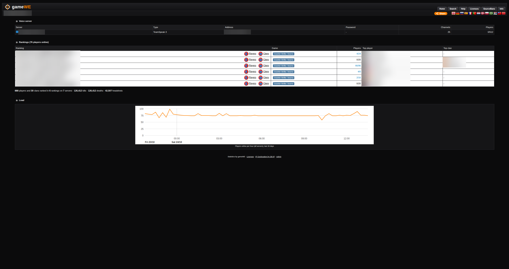

**Servers: who is playing now on a map, load graph**

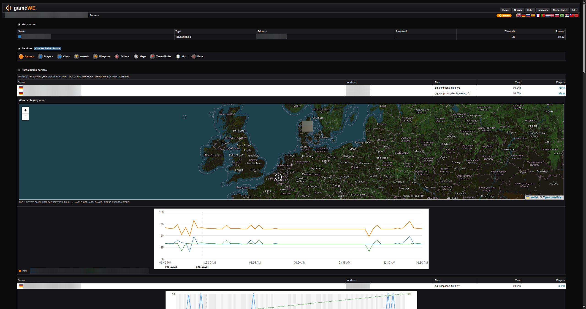

**One server: live view, load of the last 24 hours, counters**

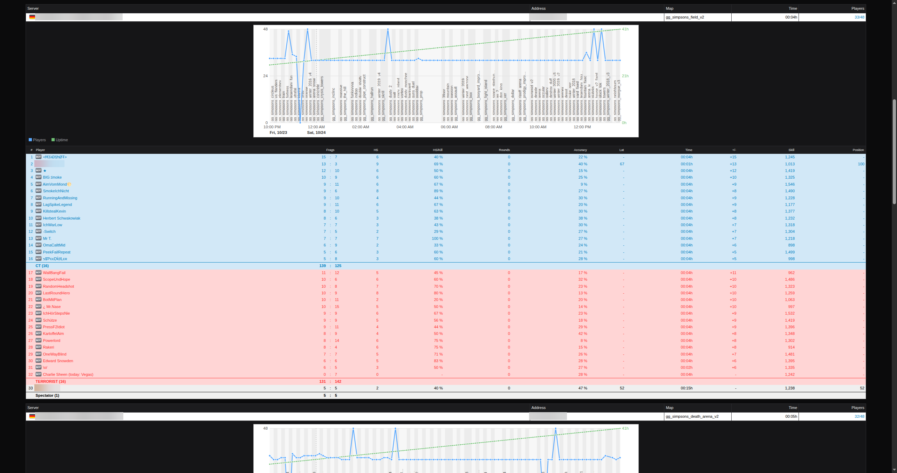

**Player ranking**

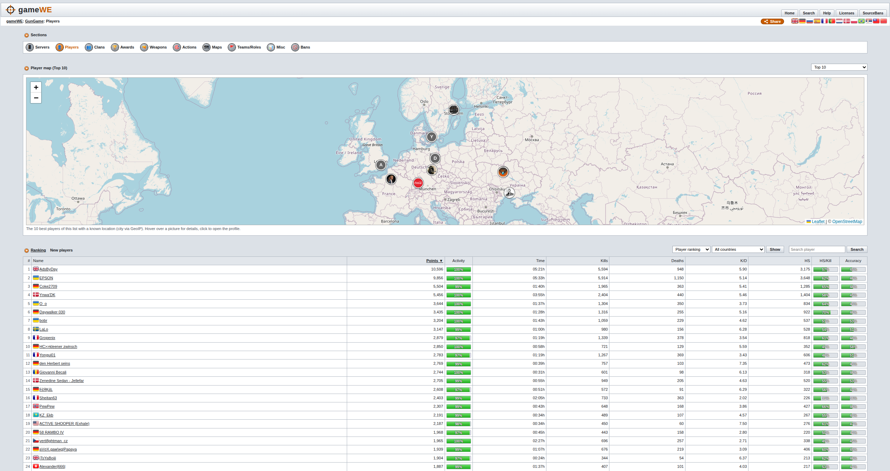

**Player profile: summary, trend, rank and career**

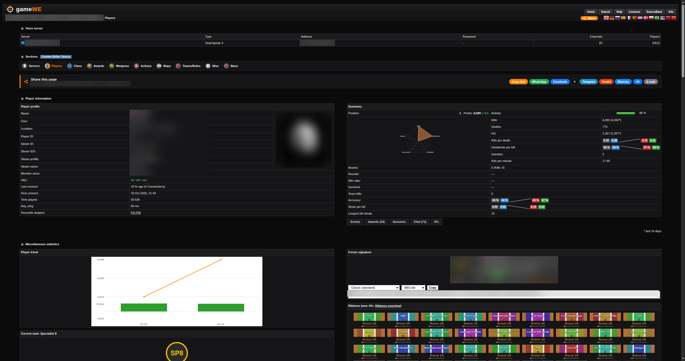

**Player profile: hitbox**

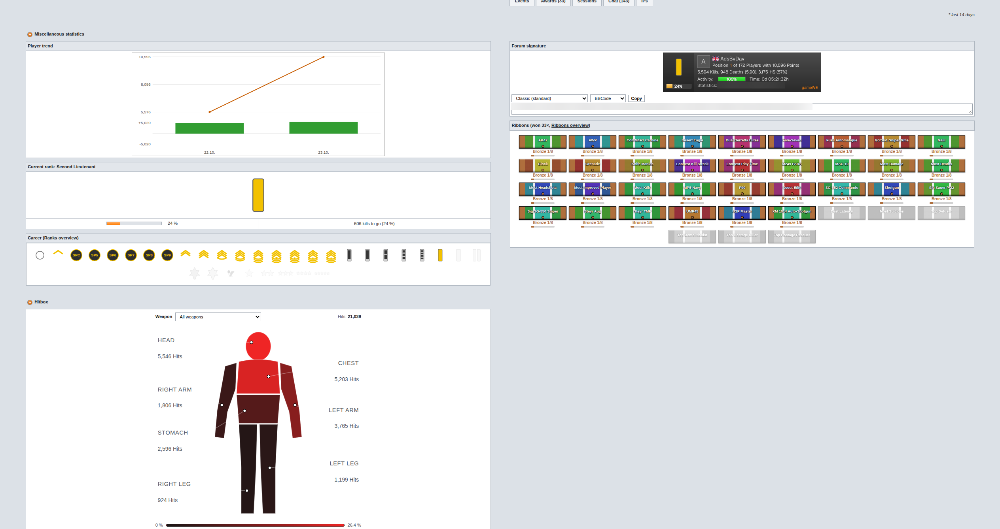

**Player profile: weapons**

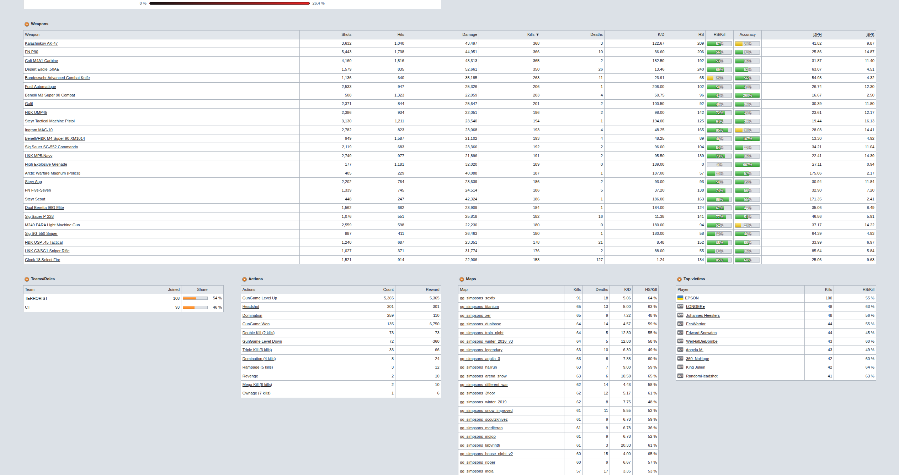

**Player history per day**

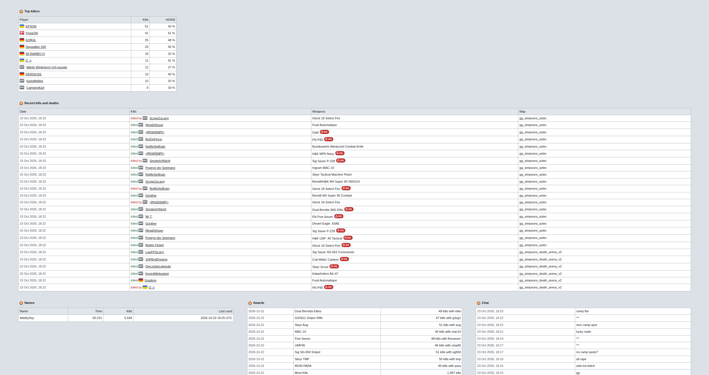

**Daily awards with calendar**

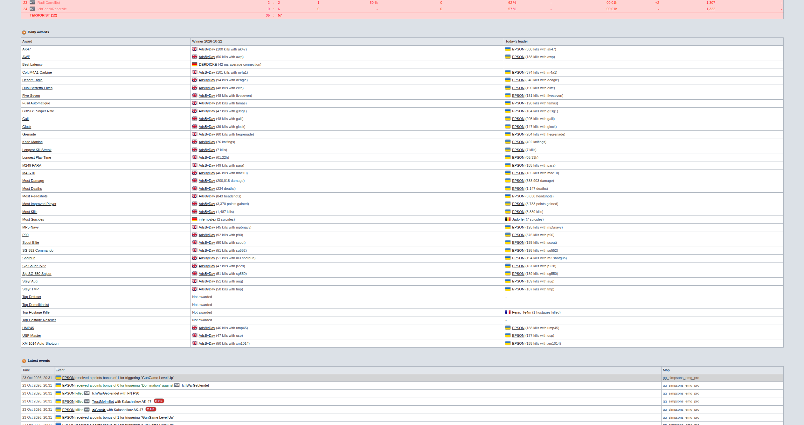

**Activity**

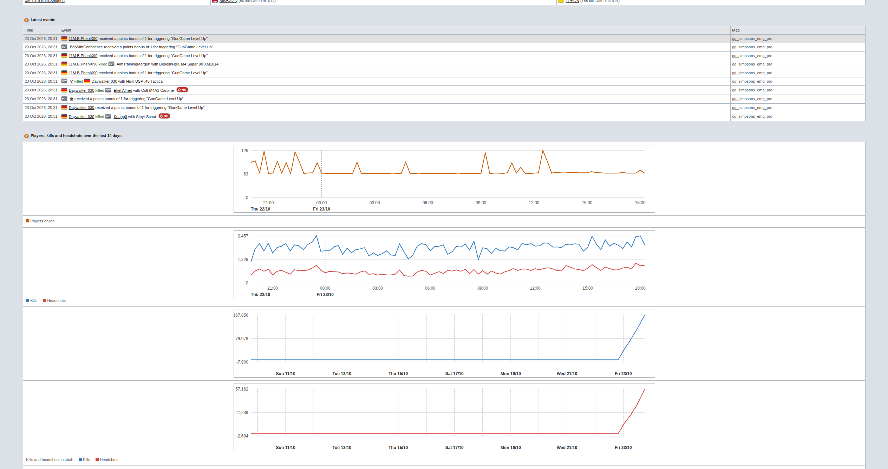

**Misc: countries, weekdays, connects**

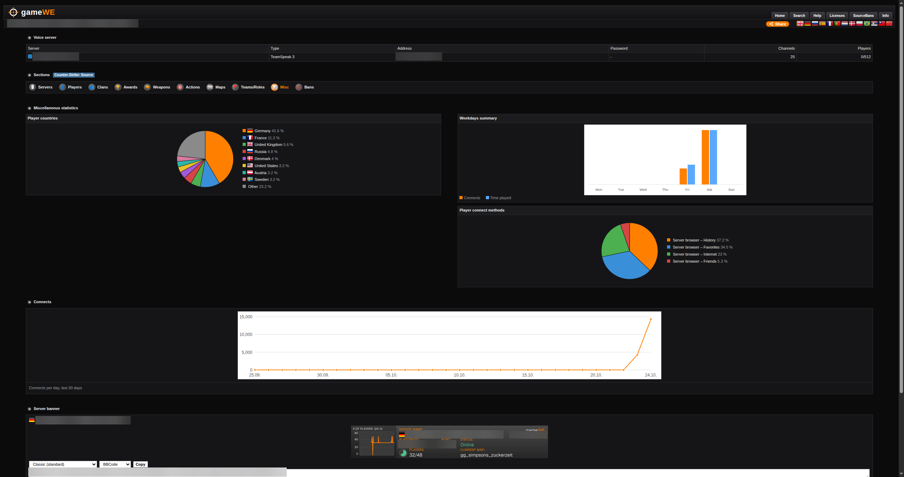

## Requirements

- The [gameWE collector](https://github.com/DennisPohlmann/gameWE-collector)
  with its database: MariaDB 11.4 or 12.3, or PostgreSQL 17 or 18
- Docker (the image brings Node.js 24 LTS on Alpine Linux), or Node.js 22 or
  newer for the tar.gz (Node.js 24 LTS recommended)
- A reverse proxy with TLS (nginx, Caddy, Apache) in front of port 3000

## Quick start with Docker

Database, collector and web on one Docker host, ready in a few minutes. Every
`change-me` is a placeholder: replace it with your own password (no `'`, `\`
or `$`), the same value everywhere it appears. The database only listens on
`127.0.0.1` and in the Docker network; the admin login is signed with a
random secret (step 4), never with a value from this page.

| Port | Container | For |
|------|-----------|-----|
| `41337/udp` | collector (host network) | the logs of the game servers (`logaddress_add`); open it in the firewall for the game servers |
| `3000/tcp` | web | the website and the admin area: `http://<docker host>:3000` |
| `3306/tcp` | database | only on `127.0.0.1`, for the collector |

The collector runs in the host network: it recognises a game server by the
source address of its log packets, which a published port (`-p`) can replace.

**1. Network and database** (MariaDB 12.3)

```bash
docker network create gamewe

docker run -d --name gamewe-db --restart unless-stopped \
  --network gamewe \
  -p 127.0.0.1:3306:3306 \
  -e MARIADB_ROOT_PASSWORD=change-me-root \
  -v gamewe-db:/var/lib/mysql \
  mariadb:12.3
```

**2. Database users** (once; waits until the database is up)

```bash
until docker exec gamewe-db healthcheck.sh --connect --innodb_initialized >/dev/null 2>&1; do sleep 2; done
docker exec -i gamewe-db mariadb -uroot -pchange-me-root <<'SQL'
CREATE DATABASE gamewe CHARACTER SET utf8mb4 COLLATE utf8mb4_unicode_ci;
CREATE USER 'gamewe'@'%' IDENTIFIED BY 'change-me-collector';
GRANT SELECT, INSERT, UPDATE, DELETE, CREATE, ALTER, INDEX ON gamewe.* TO 'gamewe'@'%' WITH GRANT OPTION;
CREATE USER 'gamewe_web'@'%' IDENTIFIED BY 'change-me-web';
CREATE USER 'gamewe_web_admin'@'%' IDENTIFIED BY 'change-me-web-admin';
GRANT SELECT ON gamewe.* TO 'gamewe_web_admin'@'%';
SQL
```

`gamewe` is the collector, `gamewe_web` the public pages (read only),
`gamewe_web_admin` the admin area. The collector creates the tables and
grants the two web users their table rights at its first start.

**3. Collector**

The collector reads its database connection and log port only from a config
file, not from environment variables, so it needs this short one:

```bash
mkdir -p ~/gamewe && cat > ~/gamewe/collector.yaml <<'EOF'
listen:
  udp:
    port: 41337
database:
  type: mariadb
  host: 127.0.0.1
  port: 3306
  name: gamewe
  user: gamewe
  password: "change-me-collector"
EOF

docker run -d --name gamewe-collector --restart unless-stopped \
  --network host \
  -e TZ=Europe/Berlin \
  -v ~/gamewe/collector.yaml:/etc/gamewe/collector/config.yaml:ro \
  -v gamewe-collector:/var/lib/gamewe \
  --log-opt max-size=50m --log-opt max-file=5 \
  ghcr.io/dennispohlmann/gamewe-collector:latest

docker logs gamewe-collector    # "database migrated", "listening for game server logs"
```

**4. Web**

`ADMIN_SECRET` signs the admin logins: a random value of at least 32
characters, created once and kept, also when you recreate the container
(a new one signs everybody out and makes stored TOTP keys unusable):

```bash
openssl rand -hex 32 > ~/gamewe/admin-secret && chmod 600 ~/gamewe/admin-secret

docker run -d --name gamewe-web --restart unless-stopped \
  --network gamewe \
  -p 3000:3000 \
  -e DB_TYPE=mariadb \
  -e DB_HOST=gamewe-db \
  -e DB_NAME=gamewe \
  -e DB_USER=gamewe_web \
  -e DB_PASSWORD=change-me-web \
  -e DB_ADMIN_USER=gamewe_web_admin \
  -e DB_ADMIN_PASSWORD=change-me-web-admin \
  -e ADMIN_SECRET="$(cat ~/gamewe/admin-secret)" \
  -e TZ=Europe/Berlin \
  ghcr.io/dennispohlmann/gamewe-web:latest
```

**Or all in one with Docker Compose** (instead of steps 1 to 4):
[`docker-compose.quickstart.yml`](docker-compose.quickstart.yml) (the same
file in gameWE-collector and gameWE-web) starts database, collector and web
in one go. The database users and the collector's config are written into
the file itself; the passwords and the admin secret come from a `.env` file
next to it with random values (the file has no defaults and does not start
without them):

```bash
mkdir -p ~/gamewe && cd ~/gamewe
curl -O https://raw.githubusercontent.com/DennisPohlmann/gameWE-collector/main/docker-compose.quickstart.yml
cat > .env <<EOF
DB_ROOT_PASSWORD=$(openssl rand -hex 16)
COLLECTOR_PASSWORD=$(openssl rand -hex 16)
WEB_PASSWORD=$(openssl rand -hex 16)
WEB_ADMIN_PASSWORD=$(openssl rand -hex 16)
ADMIN_SECRET=$(openssl rand -hex 32)
EOF
chmod 600 .env
docker compose -f docker-compose.quickstart.yml up -d
docker compose -f docker-compose.quickstart.yml logs collector   # "database migrated", "listening for game server logs"
```

**5. Admin user, rankings and servers**

Create the first admin user; it prints the password once:

```bash
docker exec -it gamewe-web node scripts/create-admin.mjs admin
# Compose: docker compose -f docker-compose.quickstart.yml exec web node scripts/create-admin.mjs admin
```

Open `http://<docker host>:3000` and sign in at `http://<docker host>:3000/admin`
with `admin` and that password. One ranking per game is already there (`css`,
`cs2`, `csgo`, `tf`, `dods`, `l4d2`, `cstrike`, ... ; `gamewe game list`
shows all). Then add your game servers, in the web admin or with the
collector's command line; both write the same database and the collector
picks the change up within a minute.

- **Web admin:** Rankings, pick the game's ranking (or create your own, e.g.
  "CS:S Public", copying a game's weapons and actions), "Add server": address,
  game port, RCON password.
- **Command line** (the `gamewe` binary in the collector container; it asks
  before it changes something):

  ```bash
  # an own ranking, with the weapons, actions, awards and ranks of css (optional)
  docker exec -it gamewe-collector /opt/gamewe/collector/bin/gamewe game add css1 "CS:S Public" -template css
  # the game server: its address and game port, the ranking, the RCON password
  docker exec -it gamewe-collector /opt/gamewe/collector/bin/gamewe server add 203.0.113.7:27015 -game css1 -name "Public" -rcon-password change-me-rcon
  docker exec -it gamewe-collector /opt/gamewe/collector/bin/gamewe server list
  # Compose: docker compose -f docker-compose.quickstart.yml exec collector /opt/gamewe/collector/bin/gamewe ...
  ```

Everything else (points, awards, in-game commands, design, users) is set
in the web admin.

**6. Game servers: send the logs to the collector**

Add to the `server.cfg` of each game server (`<docker host>` is the address
the game server reaches the collector at):

```
log on
logaddress_add <docker host>:41337      // the collector's address and UDP port
rcon_password "change-me-rcon"          // the same as in the web admin / server add
```

and restart the map or the server. With the RCON password stored, the
collector also checks every minute that it is registered as log address
and adds itself (`logaddress_add`, `log on`) when it is missing; the lines
in `server.cfg` keep it there after a restart. The first log lines show up
in `docker logs gamewe-collector`, the players on the website. For in-game
commands (`!rank`, `!top10`, ...) and more statistics install the gameWE
plugin for the engine (see gameWE components below). Optional: a log secret
against faked log packets, `sv_logsecret` (collector docs, CONFIG.md).

Counter-Strike 2 sends its logs over HTTP: add to the collector's config
(`listen:` in `~/gamewe/collector.yaml` or in the Compose file) an
`http:` part with `enabled: true` and `port: 41338`, restart the collector,
open TCP 41338 for the game servers and use
`logaddress_add_http "http://<docker host>:41338/27015"` (the game port at
the end) instead of `logaddress_add`; details in
[Counter-Strike 2](https://github.com/DennisPohlmann/gameWE-collector/blob/main/docs/GAMES.md#counter-strike-2).

For production put a reverse proxy with TLS in front of the web (bind it
to `127.0.0.1:3000:3000`), keep the collector's config file private
(`chmod 600`, owner uid `65532`), and see the installation guides of the
[collector](https://github.com/DennisPohlmann/gameWE-collector/blob/main/docs/INSTALLATION.md)
and the [web](https://github.com/DennisPohlmann/gameWE-web/blob/main/docs/INSTALLATION.md)
(PostgreSQL, TLS to the database, own templates, updates).

## Quick start

```bash
# /etc/gamewe/web/web.env: see docs/INSTALLATION.md, section 2
docker run -d --name gamewe-web --restart unless-stopped \
  -p 127.0.0.1:3000:3000 --env-file /etc/gamewe/web/web.env \
  ghcr.io/dennispohlmann/gamewe-web:latest
docker exec gamewe-web node scripts/create-admin.mjs admin
```

Then sign in at `/admin/login`. Every step, also for the tar.gz with systemd
and the reverse proxy: [docs/INSTALLATION.md](docs/INSTALLATION.md).

## Documentation

| File | Content |
|------|---------|
| [docs/INSTALLATION.md](docs/INSTALLATION.md) | installation step by step: database users, settings file, container, tar.gz, reverse proxy, update, troubleshooting, removal |
| [docs/CONFIG.md](docs/CONFIG.md) | environment variables, settings moved into the database, languages, search engines, voice server, access log |
| [docs/USAGE.md](docs/USAGE.md) | pages, where the data comes from, admin area, health and monitoring |
| [docs/INTERFACE.md](docs/INTERFACE.md) | database access and the public JSON API |
| [docs/DEVELOPMENT.md](docs/DEVELOPMENT.md) | local development, building, CI and releases |
| [templates/README.md](templates/README.md) | own design templates |
| [overviews/README.md](overviews/README.md) | map pictures under the heatmap |
| [CHANGELOG.md](CHANGELOG.md) | changes per version |
| [THIRD-PARTY-LICENSES.md](THIRD-PARTY-LICENSES.md) | third-party components and their licenses |

## gameWE components

| Repository | Part |
|------------|------|
| [gameWE-collector](https://github.com/DennisPohlmann/gameWE-collector) | receives the game server logs and fills the database |
| [gameWE-web](https://github.com/DennisPohlmann/gameWE-web) | statistics website and admin area (this repository) |
| [gameWE-web-content](https://github.com/DennisPohlmann/gameWE-web-content) | extra design templates and map pictures, as archives ready to unpack into `/var/lib/gamewe/web/templates` and `/var/lib/gamewe/web/overviews` |
| [gameWE-plugin-sourcemod](https://github.com/DennisPohlmann/gameWE-plugin-sourcemod) | game server plugin for Source games |
| [gameWE-plugin-amxmodx](https://github.com/DennisPohlmann/gameWE-plugin-amxmodx) | game server plugin for GoldSrc games |

## Building

```bash
make package    # dist/gamewe-web-<version>-linux-amd64.tar.gz + .sha256
make image      # local Docker image gamewe-web:<version>
```

Local development, checks and the release process:
[docs/DEVELOPMENT.md](docs/DEVELOPMENT.md).

## Counter-Strike 2

Rankings of Counter-Strike 2 (Source 2) servers carry their own game tag
(CS2, in the Source 2 colour). CS2 logs no shots, so its pages leave out
shots, hits, accuracy, damage per hit and shots per kill; damage and the hit
zones (with the neck, which only CS2 logs) come from its attacked lines. The
heatmap of de_nuke, de_train and de_vertigo shows the upper or the lower level alone on
request.
CS2 has no plugin, so in-game commands get no answer. Setting up the server
(HTTP log) is described in the collector's documentation.

## Counter-Strike: Condition Zero

Rankings of Condition Zero servers (realgame `czero`) carry their own game
tag (CS:CZ, in the GoldSrc colour) and show the same pages as Counter-Strike
1.6, including the CT/T win ratio. The collector gives czero a copy of the
cstrike definitions; the AMX Mod X plugin `gamewe_cstrike` runs on both.

## Credits

The Counter-Strike 2 support follows HLstatsX:CE by lovasatt
(https://github.com/lovasatt/hlstatsx-community-edition, GPL-2.0-or-later),
whose CS2 game definitions and HTTP log handling were the reference for the
gameWE collector's Source 2 engine. The database schema comes from
HLstatsX: Community Edition. Thanks to both projects.

## License

gameWE web is free software under the GNU General Public License, version 3
or (at your option) any later version, like the rest of gameWE. The full text
is in [LICENSE](LICENSE). The licenses of the libraries and data the website
uses (Next.js, React, Leaflet, Scalar, DB-IP/GeoLite2 and others) are listed on the
site under `/licenses`; the full list of third-party npm packages, fonts,
flags and other bundled files with their licenses is in
[THIRD-PARTY-LICENSES.md](THIRD-PARTY-LICENSES.md).
